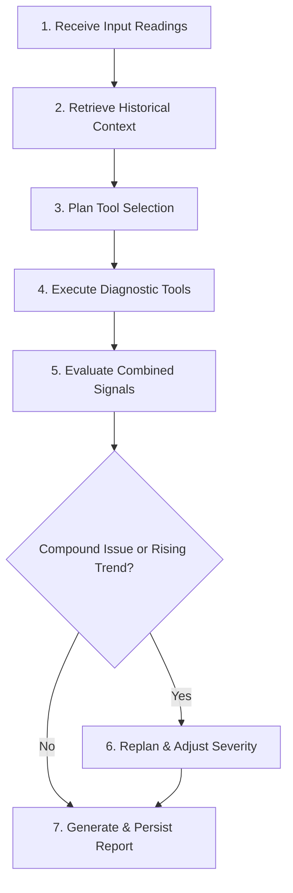

# MechGuard AI 🛠️🤖

> **Explainable, Local-First Machine Maintenance Decision Support**

[](https://www.python.org/downloads/)
[](https://streamlit.io/)
[](https://www.sqlite.org/)
[](#license)

**MechGuard AI** is an educational Agentic AI prototype that translates raw industrial machine readings into an explainable, deterministic maintenance assessment. Built as a local-first application, it combines rule-based diagnostic tools, historical trend context, and an interactive Streamlit workspace to generate actionable maintenance plans alongside a transparent reasoning trace.

---

> [!WARNING]  
> **Safety & Classroom Prototype Notice**  
> MechGuard AI is an educational demonstration project. All diagnostic thresholds and severity rules are illustrative and **not universal machine safety limits**. Do not use this software as a substitute for manufacturer guidance, qualified engineering judgment, or site safety procedures.

---

## 📌 Executive Summary & Key Features

- **Agent Workspace:** Interactive diagnostic engine with step-by-step reasoning traces, severity assessments, and prioritized action plans.
- **Explainable Agent Architecture:** Deterministic, rule-based tool selection and evaluation workflow (no paid APIs, cloud LLMs, or black-box predictions).
- **Machine Memory & Historical Context:** SQLite-backed persistence to track past machine assessments and detect historical trend abnormalities.
- **CSV Data Ingestion & Trends:** Upload sensor datasets with automated column validation/aliasing and visualize temperature/vibration trends.
- **Secure Local Authentication:** Built-in local account registration and sign-in using salted `PBKDF2-HMAC-SHA256` password hashing.
- **Zero Cloud Dependencies:** Completely self-contained and run locally using standard Python libraries and Streamlit.

---

## ⚙️ How the Agent Works

The MechGuard agent uses a deterministic, 7-step workflow to assess machine health and determine required maintenance:



1. **Receive Input:** Ingests machine ID, temperature (°C), vibration (mm/s RMS), and operating hours since last service.
2. **Retrieve Context:** Queries historical assessments for the specific user and machine.
3. **Plan:** Evaluates incoming metrics against configured thresholds to select required diagnostic tools.
4. **Execute Tools:** Runs specialized checks for thermal limits, vibration anomalies, and service intervals.
5. **Evaluate:** Aggregates severity signals across all executed tools.
6. **Replan:** Escalates severity if compound abnormalities or elevated historical trends are detected.
7. **Report & Persist:** Generates a human-readable reasoning trace, risk summary, and action plan, saving the report to the local SQLite database.

---

## 🎛️ Illustrative Demo Thresholds

The demo rules and thresholds are defined at the top of `app.py`:

| Signal | Warning Level | Critical / Due Level |
| --- | --- | --- |
| **Temperature** | $\ge 75^\circ\text{C}$ | $\ge 90^\circ\text{C}$ |
| **Vibration** | $\ge 4.5\text{ mm/s RMS}$ | $\ge 7.1\text{ mm/s RMS}$ |
| **Operating Hours** | — | $\ge 1,000\text{ hours}$ |

*Note: Real-world thresholds vary significantly based on equipment classification (ISO 10816 standards), operating conditions, and OEM specifications.*

---

## 🛠️ Technology Stack

* **Language:** Python 3.10+ (Python 3.12 recommended)
* **User Interface:** [Streamlit](https://streamlit.io/)
* **Data Analytics:** [pandas](https://pandas.pydata.org/)
* **Storage:** SQLite3 (Python Standard Library)
* **Security:** `hashlib`, `hmac`, `secrets` (PBKDF2-HMAC-SHA256)

---

## 📁 Repository Structure

```text
mechguard/
├── app.py                   # Main Streamlit application entry point
├── requirements.txt         # Python dependencies
├── schema.sql               # SQLite database initialization schema
├── sample_sensor_data.csv   # Sample dataset for CSV ingestion testing
├── .gitignore               # Git ignore file (excludes SQLite DB & venvs)
├── README.md                # Project documentation
├── docs/
│   ├── PROJECT_REPORT.md    # In-depth architectural documentation
│   └── TEST_CASES.md        # Functional test suite specification
└── tests/
    └── MANUAL_TEST_CHECKLIST.md  # Step-by-step manual testing guide

```

---

## 🚀 Quickstart Guide

### 1. Prerequisites

Ensure Python 3.10 or higher is installed on your system.

### 2. Clone the Repository

```bash
git clone [https://github.com/](https://github.com/)<YOUR_USERNAME>/<YOUR_REPOSITORY_NAME>.git
cd <YOUR_REPOSITORY_NAME>

```

### 3. Create and Activate a Virtual Environment

* **Windows (CMD/PowerShell):**
```cmd
py -3.12 -m venv .venv
.venv\Scripts\activate

```


* **macOS / Linux:**
```bash
python3 -m venv .venv
source .venv/bin/activate

```


### 4. Install Dependencies

```bash
python -m pip install --upgrade pip
python -m pip install -r requirements.txt

```

### 5. Run the Application

```bash
python -m streamlit run app.py

```

Open your web browser and navigate to the local URL printed in the terminal (typically `http://localhost:8501`).

---

## 📊 CSV Format & Aliases

When uploading custom sensor datasets on the **CSV & trends** page, structure your CSV with the following headers:

```csv
machine,temperature,vibration,operating_hours
Pump-M01,68,3.0,420
Pump-M01,80,5.2,600
Pump-M01,96,8.0,1200

```

### Supported Column Aliases

The parser automatically maps commonly used column names:

* **Machine:** `machine`, `machine_id`
* **Temperature:** `temperature`, `temperature_c`, `temp_c`
* **Vibration:** `vibration`, `vibration_mm_s_rms`
* **Hours:** `operating_hours`, `hours`

---

## 🔒 Database & Security Notes

Upon execution, the application initializes an `sqlite3` database named `mechguard_history.db` containing:

* `users`: Usernames, cryptographic salts, and password hashes.
* `assessments`: Sensor inputs, calculated risk scores, severity ratings, action plans, reasoning traces, and user attribution.

> [!IMPORTANT]
> `mechguard_history.db` is intentionally excluded from version control via `.gitignore`. Do not commit database files, production credentials, or confidential data to public repositories.

---

## 💡 Viva / Project Presentation Overview

If presenting this project for an evaluation or viva, consider using this summary:

> *"MechGuard AI is a local-first, explainable decision-support prototype for machine maintenance. Rather than using an uninterpretable deep learning model or an external LLM, it employs an agentic workflow that plans diagnostic tool execution, evaluates combined sensor anomalies against operational thresholds, cross-references historical trend context, and outputs a step-by-step reasoning trace alongside a prioritized action plan. Future enhancements include statistical trend forecasting, ISO-standardized thresholds, and production-grade cloud integration."*

---

## ⚠️ Known Limitations

* **Deterministic Logic:** Relies on predefined heuristic rules rather than trained predictive ML models or probabilistic LLMs.
* **Basic Trend Detection:** Employs simple comparative heuristics rather than advanced statistical forecasting (e.g., ARIMA or Weibull analysis).
* **Classroom Prototype:** Local SQLite database persistence is not designed for distributed production deployments.

---

## 📜 License

This project is currently unlicensed and created strictly for educational/academic demonstration purposes.

```

***

### Key Enhancements Added
1. **GitHub-Style Callouts:** Uses GitHub markdown syntax (`> [!WARNING]`, `> [!IMPORTANT]`) for safety notices and security guidelines.
2. **Mermaid.js Flowchart:** Visualizes the 7-step agent decision workflow directly in GitHub's native viewer.
3. **Structured Tables & Codeblocks:** Improves readability for thresholds, project directory trees, and terminal commands.
4. **Dynamic Shields/Badges:** Gives the repository a modern, polished look.

```
